# A Brief History of Calsinah

A brief history of [[Calsinah]] as recorded by [[Ara'ash Om'rehn]] in their book [[On Times and Lifes Past]]

<!-- DataviewJSToSerialize:
const TIMELINE = "History of Calsinah";

function parseFcDate(fcDate) {
    if (!fcDate) return null;
    const m = String(fcDate).match(/^(-?\d+)-(\d+)-(\d+)$/);
    if (!m) return null;
   
    return {
        year: Number(m[1]),
        month: Number(m[2]),
        day: Number(m[3])
    };
}

function compareFcDates(a, b) {
    const da = parseFcDate(a);
    const db = parseFcDate(b);
   
    if (!da || !db) return 0;

    if (da.year !== db.year) return da.year - db.year;

    if (da.month !== db.month) return da.month - db.month;

    return da.day - db.day;
}

function inEra(eventDate, eraStart, eraEnd) {
    return (
        compareFcDates(eventDate, eraStart) >= 0 &&
        compareFcDates(eventDate, eraEnd) <= 0
    );

}

async function getEventBody(page) {
    const file = app.vault.getAbstractFileByPath(page.file.path);
    let text = await app.vault.cachedRead(file);

    // Remove frontmatter
	text = text.replace(/^---\n[\s\S]*?\n---\n*/, "");

	// Remove leading H1
	text = text.replace(/^# .*?\n+/m, "");
   
    const marker = "%%aat-event-end-of-body%%";
    const idx = text.indexOf(marker);

    if (idx >= 0)
        text = text.substring(0, idx);

    return text
		// [[Target#Heading|Display]] → Display
	    .replace(/\[\[[^|\]]+\|([^\]]+)\]\]/g, "$1")
	    // [[Target#Heading]] → Target
	    .replace(/\[\[([^#|\]]+)(?:#[^\]]*)?\]\]/g, "$1")
	    .replace(/\n+/g, " ")
	    .replace(/\|/g, "\\|")
	    .replace(/:/g, " -")
	    .trim();;
}

const eras = dv.pages()
		    .where(p =>
		        p.type == "historical_era" &&
		        p["aat-render-enabled"] === true &&
		        p["aat-timelines"] &&
		        p["aat-timelines"].includes(TIMELINE)
		    )
		    .array()
		    .sort((a, b) =>
			    compareFcDates(a["fc-date"], b["fc-date"])
		    );

const events = dv.pages()
			    .where(p =>
			        p.type == "historical_event" &&
			        p["aat-render-enabled"] === true &&
			        p["aat-timelines"] &&
			        p["aat-timelines"].includes(TIMELINE)
			    );

let mermaid = "timeline TD\n";

for (const era of eras) {
	const eraStart = parseFcDate(era["fc-date"]);
	const eraEnd = parseFcDate(era["fc-end"]);

	let eraStartString;
	let eraEndString;

	if (eraStart != null) {
		const eraStartYear = eraStart.year;
		if (eraStartYear >= 0) {
			eraStartString = `${eraStartYear} AFL`;
		} else {
			eraStartString = `${Math.abs(eraStartYear)} BFL`;
		}
	} else {
		eraStartString = "The Beginning of Time";
	}

	if (eraEnd != null) {
		const eraEndYear = eraEnd.year;
		if (eraEndYear >= 0) {
			eraEndString = `${eraEndYear} AFL`;
		} else {
			eraEndString = `${Math.abs(eraEndYear)} BFL`;
		}
	} else {
		eraEndString = "Today"
	}

    const eraTitle =
        `${era.file.name} • (${eraStartString} → ${eraEndString})`;
    mermaid += `    section ${eraTitle}\n`;

    const eraEvents = events
        .where(e => inEra(
            e["fc-date"],
            era["fc-date"],
            era["fc-end"]
        ))
        .array()
        .sort((a, b) =>
        compareFcDates(a["fc-date"], b["fc-date"]));

    for (const event of eraEvents) {
        const body = await getEventBody(event);
       
        const eventStart = parseFcDate(event["fc-date"]);
		const eventEnd = parseFcDate(event["fc-end"]);

		let eventStartString;
		let eventEndString;

		if (eventStart != null) {
			const eventStartYear = eventStart.year;
			if (eventStartYear >= 0) {
				eventStartString = `${eventStartYear} AFL`;
			} else {
				eventStartString = `${Math.abs(eventStartYear)} BFL`;
			}
		} else {
			eventStartString = "The Beginning of Time";
		}

		if (eventEnd != null) {
			const eventEndYear = eventEnd.year;
			if (eventEndYear >= 0) {
				eventEndString = `${eventEndYear} AFL`;
			} else {
				eventEndString = `${Math.abs(eventEndYear)} BFL`;
			}
		} else {
			eventEndString = "Today"
		}
        const dateLabel =
            event["fc-end"] &&
            event["fc-end"] !== event["fc-date"]
                ? `${eventStartString} → ${eventEndString}`
                : `${eventStartString}`;

        const title =
            `${event.file.name} • (${dateLabel})`;
        mermaid += `        ${title} : ${body}\n`;
    }
    mermaid += "\n";
}

dv.paragraph(
`~~~mermaid

${mermaid}

~~~`
);

function extractNoteName(label) {
    return label.split("•")[0].trim();
}

// Era headers
document.querySelectorAll("g.pele-section").forEach(section => {
    const note = extractNoteName(section.dataset.id ?? "");
    if (!note) return;
    section.style.cursor = "pointer";
    section.addEventListener("click", () => {
        app.workspace.openLinkText(note, "", false);
    });
});

// Event boxes AND event text
document.querySelectorAll("g.pele-period").forEach(period => {
    const note = extractNoteName(period.dataset.id ?? "");
    if (!note) return;
    period.style.cursor = "pointer";
    period.addEventListener("click", e => {
        e.stopPropagation();
        app.workspace.openLinkText(note, "", false);
    });
});
-->

```mermaid

timeline TD
    section The Compounding • (200000 BFL → 90001 BFL)

    section The Draconic Ages • (90000 BFL → 54001 BFL)
        Birth of Bahamut and Tiamat • (90000 BFL) : From the essence of the elements twin deities were born. And though both stemmed from the same essence, they were like two sides of a coin. One was known as Bahamut, the Platinum Dragon, the god of justice and nobility. The other became known as Tiamat, the Queen of Chaos, goddess of wealth, greed and vengeance. The twin gods would forever oppose each other and so would their spawn.
        Birth of Dragonkind • (80000 BFL) : From the first deities of Calsinah spawned the first sentient life. In their own image they created dragonkind. Tiamat formed the Chromatic Dragons, who follow her goals, while Bahamut created the Metallic Dragons in his likeness. Despite always opposing each other and persisting conflict, for many millennia, dragonkind would life in relativ peace and share Calsinah with each other and their forefathers of the elements.

    section The Age of Divinity • (54000 BFL → 23001 BFL)

    section The First Sundering • (23000 BFL → 10001 BFL)

    section The High Age • (10000 BFL → 5001 BFL)
        The Investiture • (10000 BFL) : When at the end of The First Sundering the veil between planes briefly collapsed, the land got suffused by otherworldly energy, leaving behind powerful ley lines and magically affine creatures such as the Elves, Dwarves and Gnomes got invested by the energy of other realms. In most places the veil was restored by the winning gods quickly, but in some places the veil remains broken or thinned, leaving behind gateway to other planes.

    section The Second Sundering • (5000 BFL → 2301 BFL)

    section The Age of Transformation • (2300 BFL → 0 AFL)
        Arcane Revolution of Aashin • (764 BFL → 759 BFL) : The Arcane Revolution of Aashin followed the year long mistreatment of mages in the Aashin Sovereignty. In the process the Aashin royal family was executed and the Triumvirate of Lysoov was established as the new governing body. The Aashin Sovereignty was renamed to the Dominion of Riaaroshin and was ruled as a magocracy following the revolution.
        Birth of Iahl • (709 BFL) : Iahl was a sorcerer born to tremendous power and talent. He would hone his powers relentlessly, eventuall ascending to godhood and becoming the god king of the Vibrosyhn Empire.
        Founding of the College of Ascendancy • (621 BFL) : Among the Triumvirate of Lysoov's primary goals was the study and improvement of the arcane arts. As such, the second generation of the Triumvirate established the College of Ascendancy in Jiimar. It was established with twelve faculties, specializing in different aspects of the arcane, though they were distinct from the schools of magic as they are known today.  The college was the most prestigious institution in the Dominion of Riaaroshin and developed tremendous political influence over the time if it's existence.
        The Extinguishment • (602 BFL → 594 BFL) : The Vibrosyhn Martial Court outlawed the use of magic for any use other than purposes of state, calling for all mages to register with the government. Any mage presumed to be using the arcane arts outside of approved uses was arrested and executed without trial. In 597 BFL the use of magic was banned completely and all mages were to be executed. Already, many of the more resourceful casters had gone into hiding, with more following after the ban. This policy would eventually lead to an uprising led by a group of exiled archmages, who had called upon Iahl to aid them, resulting in Iahl taking the Vibrosyhn throne as god king.
        Ascension of Iahl • (598 BFL) : The powerful sorcerer Iahl was known to aid any in need using his powers. Additionally, he was well known for developing unique spells or amenities of the arcane. In 598 BFL he ascended to godhood, making him the god of progress and benevolence.
        The Spring of Mages • (594 BFL) : Following the total ban of magic by the Vibrosyhn Martial Court and the brutal persecution of mages in the Vibrosyhn Empire, numerous mages fled and went into hiding. Iahl, who had newly ascended to godhood, was called upon by his followers to aid them. Seeing the pain caused by the Vibrosyhn Martial Court and the stop it put to progress, Iahl killed the members of the Martial Court and with a group of Archmages in hiding established himself as god king of the Vibrosyhn Empire, ushering in an age of progress and wealth.
        Uprising of Jiimar • (431 BFL → 429 BFL) : With the College of Ascendancy growing more and more powerful, the Triumvirate of Lysoov started imposing more and more restrictions on the magic activities of the public and the development of power and the arcane arts at the college. In 431 BFL the arrest of several students of the College lead to student protests, which quickly escalated. Many faculty members, in particular the twelve heads of faculty - known as the twelve Ancients - supported the students in their protests, which resulted in the Triumvirate of Lysoov being removed from power by the Ancients in 429 BFL. The result was the establishment of the Congregate of Ancients as the new power of state. While the Triumvirate already aimed to improve the powers they wielded, the Congregate of Ancients had an agenda that pursued this goal far more ruthlessly.
        Seizing of the Primordial Forge and Battle of Uaynahr • (339 BFL) : As the Congregate of Ancients started pursuing their goal of ultimate arcane power more and more ruthlessly, they started eyeing the achievements of the Vibrosyhn Empire under Iahl rule more and more jealously. So, eventually, the seized the Primordial Forge, one of the core achievements of research under Iahl. This lead to the Battle of Uaynahr and triggered the War of the Arcane.
        War of the Arcane • (339 BFL → 0 AFL) : The War of the Arcane was a major, centuries long war between the Vibrosyhn Empire and the Dominion of Riaaroshin, culminating in the Fall of Limihn.
        Siege of Quadiin • (38 BFL → 6 BFL) : The Siege of Quadiin was on of the major engagements in the War of the Arcane. Following a steady advance by the Vibrosyhn Empire on Riaaroshin positions, they eventually reached Quadiin, one of the most important cities in the Dominion of Riaaroshin. After a prolonged siege, Riaaroshin forces eventually managed to break the siege and free the city but at great cost, leaving them severely weakened.
        Retaking of the Primordial Forge • (3 BFL → 3 BFL) : After the Siege of Quadiin, the Riaaroshin forces were left severly weakened by the battle and a large movement of troops was necessary to eventually break the siege. This allowed for the Vibrosyhn Empire to finally retake the Primordial Forge, taking away the one edge the Riaaroshin had left in the war. This loss eventually led the Congregate of Ancients to casting The Moonstrike in hopes of retaking the war.
        The Moonstrike • (0 AFL) : The Moonstrike marked the culmination of the War of the Arcane. After decades of bloody war, the Congregate of Ancients decided to end the war by destroying their enemies of the Vibrosyhn Empire through a ritual casting, calling upon the power of the moon and levelling the city of Hariosylth. For this, all twelve of them gathered on Mount Aossiin to perform a ritual on a scale that has never before been seen on Calsinah. While the casting was successful and Hariosylth was destroyed completely, leaving nothing but a vitrified track, known as the Scar of Hariosylth, behind, it drained Limihn of its essence almost completely, causing its subsequent fall.
        Fall of Limihn • (0 AFL) : Following the ritual casting of The Moonstrike by the Congregate of Ancients and the ensuing destruction Hariosylth, Limihn, the first moon of Clasinah, lost its essence and began to fall. The Fall of Limihn therefore marks the most cataclysmic event in the modern history of Calsinah, wiping out most major kingdoms from before the fall and forcing civilization mostly underground for years to follow.

    section The Age of Darkness • (0 AFL → 212 AFL)

    section The Resurgency • (213 AFL → Today)

```

<!-- SerializedDataviewJS -->

<!-- SerializedDataviewJS END -->

## Origins

## Development

## Major Turning Points

## Legacy

## Related Events

## Notes
